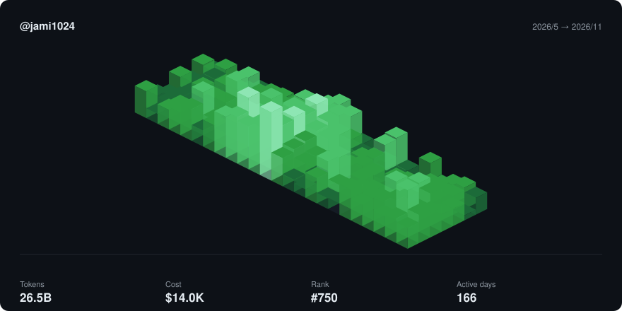

# Jami

别听我说，看我 agent 干的活

## 🧭 关于

在北京做游戏运维，日常关心**自动化与稳定性建设**。

## 🛠 技术栈

| 领域 | 使用 |
| --- | --- |
| 语言 | `Go` `Python` `TypeScript` |
| 前端 | `Vue` `React` |
| 运维 | `Kubernetes` `Docker` `监控告警` `定时任务平台` |
| AI | `Claude CLI` `Codex CLI` `pi` · 自建 skills 库 |

## 🔍 最近在看

- **Agent 运行时** — 工具调用、上下文压缩、失败重试这些底层机制
- **Skills 与 MCP** — 把重复的运维操作变成 Agent 能直接调的能力

## 📊 AI 用量

近 24 周每天的 token 用量，柱高按日用量开方压缩 · 每天自动更新 · 数据来自 [Tokscale](https://tokscale.ai/u/jami1024)

---

Last updated: 2026-11
